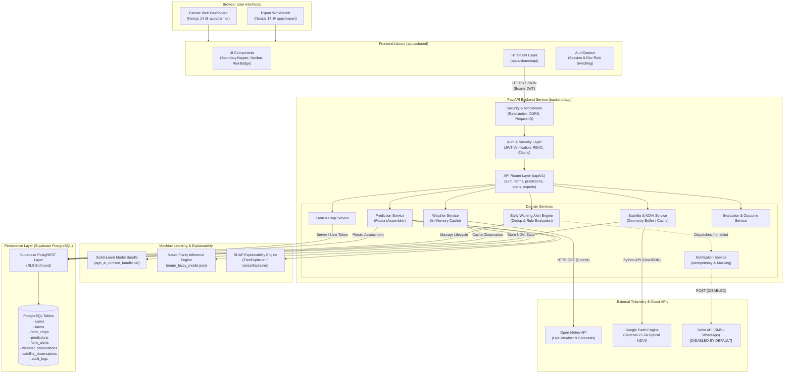

# AI Crop Failure Project: Reducing Crop Failure Using AI Under Unfavorable Weather Conditions

An AI-driven decision-support platform designed to assist farmers, agricultural extension officers, agronomists, and researchers in estimating crop failure risks, exploring climate-resilient crop alternatives, and simulating agricultural stress scenarios.

---

## 📌 Executive Summary & Architecture (Version 1 vs. Version 2)

### Existing Version 1 (Preserved & Live)
- **Live Streamlit Application**: [https://reducecropfailure.onrender.com/](https://reducecropfailure.onrender.com/)
- **Nature**: Python/Streamlit prototype combining historical district baseline datasets, scikit-learn models (`models/agri_ai_bundle.pkl`), and live Open-Meteo weather forecasting.
- **Isolation Guarantee**: Version 1 is deployed independently on Render and **must remain untouched**. Version 2 development and staging operate on separate branches and staging targets without impacting Version 1.

### Version 2 Architecture (Current Staging Target)
Version 2 evolves the platform into a decoupled, multi-tenant web application:
1. **Frontend**: Next.js 14 App Router workspaces (`apps/farmer` for smallholders and `apps/expert` for agricultural researchers/agronomists) backed by a shared UI/API component library (`apps/shared`).
2. **Backend**: FastAPI RESTful backend service (`backend/app/`) with JWT authentication, tenant isolation, Row-Level Security (RLS), and rate limiting.
3. **Database & Auth**: Supabase PostgreSQL with 12 forward migrations, PostgREST APIs, and role-based access control (`farmer`, `expert`, `admin`).
4. **Data & AI Pipelines**:
   - 16-feature stage-aware Feature Assembler.
   - Dual ML engine: Gradient Boosted / Random Forest risk estimator + Neuro-Fuzzy inference system (`models/neuro_fuzzy_model.json`).
   - SHAP explanation engine (`LinearExplainer` and `TreeExplainer`).
   - Open-Meteo live weather client with coordinate boundary validation and caching.
   - Google Earth Engine / Sentinel-2 L2A satellite vegetation provider (NDVI statistics from polygon geometry with synthetic fallback).
   - Early warning alert engine (`farm_alerts`) with stateful lifecycle management (active, acknowledged, resolved).
   - Ground-truth outcome collection and model evaluation readiness engine.

---

## 🏛️ System Architecture

The following diagram illustrates the component architecture, communication boundaries, authentication layers, and external service interactions in Version 2:



---

## 📐 System Design Details

### A. Presentation Layer & Unified Single-Login Architecture
- **Unified Single-Login Experience (`ONE LOGIN`)**: All authenticated users log in through a single authentication flow and land on the main farmer dashboard and field operations by default. No separate login or registration is required to access advanced features.
- **Farmer Dashboard (`apps/farmer`)**: Tailored for field accessibility and smallholder operations. Features:
  - **Top-Left Profile Access**: "My Profile & Account Settings" is pinned at the top-left of the sidebar for immediate account and notification management across any view.
  - **Sidebar Field Selectors**: Real-time district, season, year, and crop selection updating the live risk assessment and comparative table.
  - **Open Expert Workbench**: A dedicated, prominent sidebar button allows any authenticated user to seamlessly open the **Expert Workbench** without switching accounts or re-authenticating.
- **Integrated Expert Workbench**:
  - Embedded directly within the dashboard under the `expert` view with a 1-click **← Return to Farmer Operations** button.
  - Includes:
    - **Diagnostic Overview**: Production ensemble architecture weights (Global 40%, Regional 35%, Crop-specific 25%), baseline model performance metrics (ROC-AUC, F1, Brier score), and global feature importance attributions.
    - **Takagi-Sugeno Neuro-Fuzzy AI Benchmark**: 6 canonical domain rules, Gaussian bell antecedents, and live parameter evaluation.
    - **SHAP Explainability**: Deep TreeExplainer feature attributions for any simulated or farm observation.
    - **Scenario Twin Simulator**: Parametric sliders for rainfall, temperature, humidity, and soil moisture stress tests.
    - **Cross-Farm EWS Incident Management & Ground-Truth Evaluation**.
- **Shared Code (`apps/shared`)**: Houses common types, Leaflet cadastral boundary mapping (`BoundaryMapper.tsx`), localization dictionaries (8 Indian languages), and HTTP API client abstractions with standard error unwrapping (`client.ts`).

### B. API Layer
- Built on **FastAPI** (`backend/app/main.py`) using modular routers under prefix `/api/v1`.
- Comprehensive Pydantic v2 schemas for all inputs and outputs with automated validation.
- Centralized exception handlers ensure internal stack traces are sanitized and never leaked to users.
- Standard health check probe available at `/health` and `/api/v1/health` for container orchestration.

### C. Authentication & Authorization
- **Unified Auth & Session Handling**: Users authenticate once via Supabase Auth, receiving a signed JWT containing server-managed `app_metadata` and user ID (`sub`).
- **One-Login Access Model**: All authenticated users can navigate between farmer operations and the expert workbench UI. Endpoints requiring administrative write actions or staff privileges enforce server-side RBAC dependencies (`get_expert_user`, `get_admin_user`).
- **User Metadata Security**: In adherence to Supabase Advisor guidelines, client-editable `user_metadata` is **never** used for role authorization. Roles are strictly evaluated via server-managed `app_metadata` or database security definer functions (`public.current_user_role()`).
- **Google OAuth Status**: The login UI provides a Google sign-in button, but Google OAuth is **not yet configured** in Google Cloud Console. In local development and testing, an authorized development role selector (`Farmer`, `Expert`, `Admin`) is provided for seamless testing without external dependencies.

### D. Machine Learning Inference & Feature Assembly Pipeline
- **Dual Inference Engine**:
  - **Primary Model Bundle (`models/agri_ai_runtime_bundle.pkl`)**: Calibrated classification ensemble combining Random Forest (`RandomForestClassifier`) and LightGBM / Gradient Boosting estimators. Maps continuous consensus risk probabilities to 3 distinct operational risk bands:
    - **Low Risk**: $[0.00, 0.35)$
    - **Medium Risk**: $[0.35, 0.65)$
    - **High Risk**: $[0.65, 1.00]$
  - **Neuro-Fuzzy Inference System (`models/neuro_fuzzy_model.json`)**: Takagi-Sugeno fuzzy logic architecture using Gaussian bell membership antecedents across 8 environmental features and 6 canonical agronomic rules for transparent validation.
- **Stage-Aware Feature Engineering (`backend/app/services/feature_service.py`)**:
  - The trained ML bundle accepts an exact 16-feature vector (6 categorical, 10 numerical):
    - **Categorical (6)**: `State`, `Region`, `Season`, `Crop`, `SoilType`, `IrrigationLevel`.
    - **Numerical (10)**: `Year`, `Rainfall`, `Temperature`, `Humidity`, `SoilMoisture`, `NDVI_Flowering`, `WaterStress`, `PestRisk`, `SuitabilityScore`, `YieldIndex`.
  - **Genuinely Integrated Live Telemetry vs. Baselines**:
    - `Temperature`: Real-time dry-bulb 2m temperature from Open-Meteo. Stale if older than 24 hours.
    - `Humidity`: Real-time 2m relative humidity (%) from Open-Meteo. Stale if older than 24 hours.
    - `SoilMoisture`: 4-layer root-zone soil moisture relative saturation (%) derived from Open-Meteo ECMWF Land model (0–27 cm: 0–1 cm, 1–3 cm, 3–9 cm, 9–27 cm).
    - `Rainfall`: Accumulated seasonal precipitation computed from daily observations if continuous history ($\ge 14$ days) is recorded for active crop cycle, or projected using baseline daily rate; falls back to historical median if unobserved.
    - `NDVI_Flowering`: **Strict Phenology Guard**: Instantaneous Sentinel-2 NDVI is **only** substituted into `NDVI_Flowering` if the crop is in its active flowering stage (evaluated by phenological stage keywords or Days After Sowing within crop-specific flowering window: e.g., Rice 55–90 DAS, Wheat 60–90 DAS, Cotton 70–115 DAS). Otherwise, calibrated district historical baselines are retained with clear `provenance` metadata.
    - `WaterStress`, `PestRisk`, `SuitabilityScore`, `YieldIndex`: Dynamic derived indices calibrated against live weather and soil type.
- **Explainability**: SHAP attributions (`TreeExplainer` and `LinearExplainer`) output top risk contributors and mitigating protective factors per prediction.
- **Tenant Isolation & Persistence**: Every farm assessment is saved in `public.predictions` with user ID, farm ID, complete feature provenance, and data quality flags.

### E. Live Weather & Meteorological Telemetry Pipeline
- **Provider & Integration**: Built on Open-Meteo's free, keyless REST API (`https://api.open-meteo.com/v1/forecast`).
- **Supported Endpoints**:
  - `GET /api/v1/weather/current?latitude={lat}&longitude={lon}`: Real-time 2m temperature, relative humidity, precipitation, wind speed (10m), weather code, and multi-layer soil moisture.
  - `GET /api/v1/weather/forecast?latitude={lat}&longitude={lon}&days={7|14}`: Daily projections including min/max temperature, precipitation sum, and weather code.
  - `GET /api/v1/weather/reverse-geocode?latitude={lat}&longitude={lon}`: Locality and district resolution via OpenStreetMap Nominatim with BigDataCloud secondary fallback and clean coordinate formatting fallback.
- **Location Integrity (Device GPS vs. Manual Selection)**:
  - **Browser Geolocation**: Initiated exclusively via user consent prompt through `navigator.geolocation`. Only marked as **GPS Verified** after the browser returns valid coordinates (`status: "granted"`).
  - **Manual Selection**: Users can select from major Indian agricultural regions or type custom coordinates (`status: "manual"`). Marked with a distinct pin icon (`📌 Manual Selection`).
  - **Prominent Place Name Resolution**: When reverse-geocoding succeeds, the returned locality, city/town, district, state, and country are formatted into a clean, deduplicated place name (e.g., `Kothnur, Bengaluru, Karnataka, India`). If geocoding fails or is rate-limited, weather continues to display uninterrupted with a clear `Place name unavailable` label and coordinates shown in the subtitle.
  - **Current User Location vs. Registered Farm Monitoring Separation**: Current device weather/location (`UserLiveWeatherWidget`) and registered farm plots (`FarmPlotMonitoringCard`) operate on two completely separate data flows. Registered farm plots use their own stored cadastral coordinates and never overwrite or borrow the user's browser location.
- **Caching & Rate Protection**: Thread-safe in-memory cache keyed by rounded coordinates (`round(lat, 3), round(lon, 3)` for geocoding; `round(lat, 4), round(lon, 4)` for weather) with 1800-second (30-minute) TTL (`WEATHER_CACHE_TTL_SECONDS`).

### E1. Live Farm Monitoring & Multi-Plot Architecture
- **Multi-Farm Grid**: The "Live Farm Monitoring & Sensors" view displays all registered plots belonging to the authenticated user as individual cards (`FarmPlotMonitoringCard`), each keyed by its stable UUID.
- **Isolated Per-Plot Telemetry**: Each farm card independently fetches its own active crop cycle, latest inferred prediction, live Open-Meteo weather station readings, Sentinel-2 NDVI canopy observations, and early warning risk trends. Metrics from one farm never bleed into or overwrite another.
- **Lifecycle & Registration Refresh**: Adding a new plot automatically refreshes the monitoring card list via window focus and session event listeners without requiring logout or application restart.
- **Zero Fabrication**: When telemetry or satellite passes are unavailable, cards display explicit unavailable states rather than synthetic or fabricated placeholder data.

### E2. Google Earth Engine (GEE) & Sentinel-2 NDVI Pipeline
- **Collection**: Harmonized Sentinel-2 Level-2A Surface Reflectance (`COPERNICUS/S2_SR_HARMONIZED`).
- **Cloud & Shadow Masking**: Dual-stage filtering combining Sentinel-2 Scene Classification Layer (SCL) and QA60 bitmask:
  - SCL bands 3 (cloud shadow), 8 (cloud medium probability), 9 (cloud high probability), 10 (cirrus), and 11 (snow) are masked.
  - QA60 bit 10 (opaque clouds) and bit 11 (cirrus) are bitwise masked.
- **NDVI Formula**: Standard normalized difference vegetation index:
  $$\text{NDVI} = \frac{\text{B8 (NIR, 842 nm)} - \text{B4 (Red, 665 nm)}}{\text{B8} + \text{B4}}$$
- **Spatial Reduction**: Cloud reduction executed directly on Google Earth Engine servers at 10m native spatial resolution across farm cadastral polygon geometries (`ee.Reducer.mean()`, `median()`, `minMax()`, `stdDev()`, `count()`). Zero raw raster arrays are downloaded to the backend.
- **Operational Status & Fallbacks**:
  - **In Development / Testing**: If Google Earth Engine credentials (`GEE_PROJECT_ID`, `GEE_SERVICE_ACCOUNT_EMAIL`, `GEE_PRIVATE_KEY`) are not provisioned, the provider safely returns status `SATELLITE_NOT_CONFIGURED` without crashing.
  - **Cloud Obscuration**: If cloud cover exceeds 30% over the 45-day window, status `SATELLITE_NO_VALID_OBSERVATION` is recorded, and the pipeline gracefully defaults to historical district baselines.
  - **NDVI Interpretation**: NDVI is strictly interpreted as a vegetation vigor and green canopy density indicator, **not** as standalone proof of crop failure. Observation date and valid pixel counts are always displayed alongside values.

### F. Data & Persistence
- **Supabase PostgreSQL**: Manages 10 core domain tables (`users`, `farms`, `farm_crops`, `predictions`, `recommendations`, `weather_observations`, `satellite_observations`, `farm_alerts`, `farm_feedback`, `audit_logs`).
- **Row-Level Security (RLS)**: Enforced across all tables. Tenant isolation ensures farmers can only query or mutate rows matching their authenticated `user_id` or owned farms.
- **Engine-Level Role Immutability**: Migration 012 installs a PostgreSQL `BEFORE UPDATE` trigger on `public.users` that rejects any unauthorized modification to `role`, `id`, `email`, or `is_active`.
- **Migration Reconciliation**: Migrations `001` through `012` must be reviewed and applied sequentially. Live Supabase instances must be inspected prior to migration application.

### G. Alerts & Notifications
- **Early Warning Alert Engine**: Evaluates 6 deterministic alert conditions (`RISK_THRESHOLD_CROSSED`, `RISK_TREND_INCREASING`, `TELEMETRY_DEGRADATION`, `SATELLITE_STALE`, `WEATHER_STALE`, `DATA_QUALITY_DEGRADED`) with automated deduplication across 4 distinct lifecycle states.
- **Notification Safety Notice**: The dispatch engine supports Twilio SMS and WhatsApp with SHA-256 idempotency deduplication and phone masking. However, **`SMS_ENABLED=false` and `WHATSAPP_ENABLED=false` by default**. Dispatches are suppressed during staging to ensure ₹0 budget compliance.

### H. Security & Reliability
- **Rate Limiting**: Sliding-window in-memory rate limiter (`SlidingWindowRateLimiter`) with automatic garbage collection protects against API abuse and brute-force attempts.
- **Defense-in-Depth Middleware**: Enforces secure HTTP headers (`X-Content-Type-Options: nosniff`, `X-Frame-Options: DENY`, `Strict-Transport-Security`) and unique request correlation tracking (`X-Request-ID`).
- **Automated Secret Audits**: Pre-commit scanner (`scripts/security_check.py`) scans code for high-risk tokens, private keys, and live JWTs before any code is staged or committed.

### I. Deployment Topology (Version 2 Staging)
- **FastAPI Backend**: Render Web Service (`crop-risk-api-staging`) deployed from `release/v2-staging` using Uvicorn.
- **Frontends**: Vercel Preview deployments for `apps/farmer` and `apps/expert`.
- **Database**: Dedicated staging schema or existing Supabase project after migration reconciliation.
- **Isolation**: Existing Version 1 Render deployment (`https://reducecropfailure.onrender.com/`) operates independently and remains untouched.

---

## 🔄 Request Lifecycle Examples

### 1. Standard Crop Failure Risk Prediction Flow
```text
1. User interacts with Farmer Dashboard or Expert Workbench.
2. Next.js API client signs request with Bearer JWT and sends POST /api/v1/predictions.
3. FastAPI Request Middleware validates correlation ID and checks SlidingWindowRateLimiter.
4. Security Dependency verifies JWT signature, parses user role, and enforces RBAC.
5. Pydantic validates input parameters (crop, season, stage, location/boundary).
6. PredictionService invokes FeatureAssembler to merge telemetry with crop growth stage baselines.
7. Model pipeline computes failure risk probability and maps to calibrated risk band.
8. SHAP Engine computes top contributing and protective feature contributions.
9. Recommendation Engine generates actionable agronomic guidance.
10. PredictionRepository persists prediction record into Supabase public.predictions (subject to RLS).
11. AlertService evaluates whether current risk or delta crosses warning thresholds.
12. Response is returned to frontend client as structured JSON.
```

### 2. Satellite & Weather-Assisted Prediction Flow
```text
1. User requests assessment for a registered farm plot (/api/v1/farms/{farm_id}/predict).
2. FarmService retrieves farm polygon coordinates and verifies user ownership via RLS.
3. WeatherService checks in-memory cache for coordinates; if stale, fetches live metrics from Open-Meteo.
4. SatelliteService queries Sentinel-2 L2A collection over farm polygon for latest cloud-free window.
5. Live NDVI statistics (mean, min, max, std) are derived; fallback baseline applied if cloudy.
6. FeatureAssembler merges live weather (temperature, humidity, precipitation) and NDVI into feature row.
7. Feature provenance metadata is constructed (distinguishing live telemetry from baseline fallbacks).
8. ML inference and SHAP explanation execute using assembled live features.
9. Telemetry observations and predictions are stored in respective Supabase tables.
10. Client dashboard renders interactive risk badge, NDVI vegetation gauge, and weather widget.
```

---

## ⚖️ Design Decisions, Trade-offs & Limitations

| Architectural Decision | Technical Rationale | Trade-off / Cost | Current Limitation |
|---|---|---|---|
| **Decoupled Frontend & Backend** | Independent scaling, mobile-optimized Next.js UI, standard REST contract. | Requires CORS handling, JWT token management, and separate build pipelines. | Two separate staging targets required (Vercel + Render). |
| **Supabase (PostgreSQL + RLS)** | Managed PostgreSQL with instant PostgREST, built-in Auth, and declarative Row-Level Security. | Tighter coupling to Supabase conventions and migration sequencing. | Direct PostgREST queries must be kept in sync with application-level schemas. |
| **Model Pre-Warmup on Startup** | Warms up scikit-learn bundle on non-testing boot to eliminate first-request latency spikes. | Adds 2–4 seconds to application cold-start boot time. | In-memory model bundle consumes ~180MB RAM per worker process. |
| **In-Memory Rate Limiting** | Zero external infrastructure required; lightweight sliding-window counter. | Counters are per-worker instance rather than globally coordinated across clusters. | Multi-worker horizontal scaling requires Redis-backed limiter in future phases. |
| **Notification Engine Capped OFF** | Prevents unexpected charges on trial Twilio accounts; ensures strict ₹0 budget. | Outbound SMS and WhatsApp alerts cannot reach farmers automatically during staging. | Manual on-demand testing required; production requires funded Twilio / WhatsApp Business account. |
| **Selective Database Migration** | Allows existing Supabase project reuse without breaking active Version 1 tables. | Requires careful verification of existing remote schemas before running migrations. | Remote database schema must be reconciled prior to live execution of Migration 012. |

---

## 🛠️ Feature Status: Implemented vs. Planned

| Feature | Subsystem | Status | Implementation Details |
|---|---|---|---|
| **One-Login Experience** | Frontend / Auth | **`IMPLEMENTED`** | Unified authentication: all users log into the single application with immediate farmer dashboard access. |
| **Integrated Expert Workbench** | Frontend / UI | **`IMPLEMENTED`** | One-click access from sidebar to deep diagnostics, SHAP, and Neuro-Fuzzy with return-to-farmer button. |
| **Live Weather Risk Prediction** | ML / Backend / UI | **`IMPLEMENTED`** | Real-time Open-Meteo telemetry merged with crop growth stage baselines. |
| **SHAP Explainability** | ML / Backend / UI | **`IMPLEMENTED`** | Top-3 risk contributors, protective factors, and waterfall charts. |
| **Farm & Crop Management** | Backend / Database / UI | **`IMPLEMENTED`** | CRUD operations with polygon boundary geometry (Shoelace area) & village fields. |
| **Cadastral Boundary Mapping** | Frontend / Leaflet | **`IMPLEMENTED`** | Interactive farm polygon drawer with GeoJSON validation and coordinate conversion. |
| **Multilingual Localization** | Frontend | **`IMPLEMENTED`** | 8 languages: English, Hindi, Marathi, Bengali, Telugu, Tamil, Kannada, Gujarati. |
| **Early Warning Alert Engine** | Backend / Database / UI | **`IMPLEMENTED`** | 6 alert types (risk spikes, telemetry degradation, stale observations). |
| **Neuro-Fuzzy Inference** | ML / Backend / UI | **`IMPLEMENTED`** | Rule-based fuzzy logic engine with Gaussian membership functions. |
| **Ground-Truth Evaluation** | Backend / UI | **`IMPLEMENTED`** | Verified outcome linkage, leakage auditing, and evaluation readiness. |
| **Supabase RLS & RBAC** | Database / Auth | **`IMPLEMENTED`** | Row-Level Security across all 10 tables, server-managed role claims. |
| **Notification Infrastructure** | Backend / Service | **`IMPLEMENTED (DISABLED)`** | Twilio SMS/WhatsApp adapter ready with idempotency; safely toggled OFF by default. |
| **Google OAuth Sign-In** | Auth / Frontend | **`PLANNED / NOT CONFIGURED`** | Client button delegates to mock dev-role fallback until Google Console credentials are configured. |
| **Automated Cron Alert Poller** | Automation | **`PLANNED`** | Endpoints are triggered on-demand; automatic cron worker planned for Phase 3. |

---

## 🏗️ Repository Directory Structure

```text
ai-crop-failure-project/
├── .github/
│   └── workflows/
│       └── ci.yml               # GitHub Actions CI (Backend, Farmer UI, Expert UI, Smoke Tests)
├── apps/
│   ├── expert/                  # Next.js 14 Expert & Agronomist Workbench
│   │   ├── app/                 # Workbench pages, Digital Twin sliders, SHAP attribution
│   │   ├── package.json         # Workspace package definition
│   │   └── test_expert.js       # Expert app automated tests
│   ├── farmer/                  # Next.js 14 Farmer Mobile-First Dashboard
│   │   ├── app/                 # Farm registration, crop monitoring, advisories
│   │   ├── package.json         # Workspace package definition
│   │   └── test_farmer.js       # Farmer app automated tests
│   └── shared/                  # Shared TypeScript library
│       ├── api/                 # Typed API clients (farms, crops, alerts, predictions)
│       ├── components/          # Reusable components (Navbar, BoundaryMapper, RiskBadge)
│       ├── context/             # AuthContext, UserLocationContext
│       ├── data/                # district_metadata.json (authoritative district centers)
│       ├── translations/        # Multilingual UI dictionaries (8 Indian languages)
│       └── types/               # TypeScript domain interfaces
├── backend/
│   ├── app/
│   │   ├── api/routes/          # FastAPI routers (auth, farms, predictions, alerts, experts)
│   │   ├── core/                # config, security, rate_limiter, logging, supabase client
│   │   ├── repositories/        # Data access layer (in-memory + Supabase PostgREST)
│   │   ├── schemas/             # Pydantic v2 domain models
│   │   ├── services/            # Business logic (prediction, alert, weather, satellite, evaluation)
│   │   └── main.py              # FastAPI application entrypoint & middleware
│   ├── requirements.txt         # Python dependencies for backend service
│   └── tests/                   # Pytest test suite (RBAC, isolation, alerts, ML regressions)
├── data/                        # Historical district datasets, predictions, and geoJSONs
├── docs/                        # Architecture specs, API contracts, security models
├── models/                      # ML bundles, specialized models, neuro-fuzzy rules
├── postman/                     # Postman collections & environment files for smoke testing
├── scripts/                     # Security scanner, API test runners, district data scripts
├── src/                         # Core ML training, SHAP, and legacy Streamlit scripts
├── supabase/
│   └── migrations/              # 12 Forward SQL migrations (001_initial to 012_fix_user_metadata_rls)
├── dashboard_app.py             # Streamlit Version 1 prototype dashboard
├── package.json                 # Monorepo workspace configuration
├── requirements.txt             # Core Python ML training requirements
└── .env.example                 # Safe environment configuration template
```

---

## 💻 Local Development Setup (Windows PowerShell & VS Code)

### Prerequisites
- **Python**: Python 3.10 to 3.12 (compatible with `scikit-learn>=1.5.0`, `pydantic>=2.8.0`, and `earthengine-api>=1.7.0`).
- **Node.js**: Node 20.x or later with `npm`.
- **Git**: Installed and configured.

### 1. Python Virtual Environment Setup

Open PowerShell in the project root:
```powershell
# Create virtual environment using Python 3.10/3.11/3.12
python -m venv venv

# Activate virtual environment
.\venv\Scripts\activate

# Upgrade pip and install dependencies
python -m pip install --upgrade pip
pip install -r backend/requirements.txt -r requirements.txt
```

### 2. Node.js & Workspace Installation

Install root and workspace dependencies:
```powershell
# Install all npm workspaces (apps/farmer, apps/expert, apps/shared)
npm install

# Run frontend test suites
npm run test:frontend
```

### 3. Environment Variables Configuration

Copy `.env.example` to `.env`:
```powershell
Copy-Item .env.example .env
```
Open `.env` and fill in your local development placeholders. **Never commit `.env` to Git.**

---

## 🔑 Environment Variable Reference

| Variable Name | Purpose | Required / Optional | Consuming Service |
|---|---|---|---|
| `APP_ENV` | Application environment (`development`, `testing`, `production`) | Required | FastAPI Backend / Logging |
| `API_VERSION` | API version routing prefix (`v1`) | Required | FastAPI Router Mounts |
| `PORT` | Local server port (Default `8000`) | Optional | Uvicorn Server |
| `HOST` | Bind host address (Default `0.0.0.0`) | Optional | Uvicorn Server |
| `CORS_ORIGINS` | Allowed frontend origins (JSON array) | Required | FastAPI CORS Middleware |
| `SUPABASE_URL` | Base URL of your Supabase project | Required in Live Mode | Backend Supabase Client |
| `SUPABASE_PUBLISHABLE_KEY` | Supabase Anon/Publishable Key | Required in Live Mode | Backend / PostgREST Client |
| `SUPABASE_SECRET_KEY` | Supabase Service Role Key (Backend ONLY) | Required in Live Mode | Backend Repositories (Server-side) |
| `SUPABASE_JWT_SECRET` | Secret key for verifying JWT tokens | Required | FastAPI `core/security.py` |
| `NEXT_PUBLIC_SUPABASE_URL` | Public Supabase project URL | Required for Live UI | Next.js Frontend Apps |
| `NEXT_PUBLIC_SUPABASE_PUBLISHABLE_KEY` | Public Supabase publishable key | Required for Live UI | Next.js Supabase Client |
| `GOOGLE_CLIENT_ID` | OAuth Client ID from Google Cloud Console | Optional (Dev Fallback) | Next.js AuthContext |
| `GOOGLE_CLIENT_SECRET` | OAuth Client Secret from Google Cloud Console | Optional (Dev Fallback) | Supabase Auth Provider |
| `OPENMETEO_BASE_URL` | Weather API endpoint (Default: Open-Meteo) | Optional | Weather Service |
| `RUNTIME_MODEL_BUNDLE_PATH` | Path to runtime ML pickle artifact | Required | `PredictionService` |
| `SMS_ENABLED` | Master switch for Twilio SMS dispatch | **Must be `false`** | Notification Service |
| `WHATSAPP_ENABLED` | Master switch for Twilio WhatsApp dispatch | **Must be `false`** | Notification Service |
| `TWILIO_ACCOUNT_SID` | Twilio Account Identifier | Optional (Placeholder) | Notification Provider |
| `TWILIO_AUTH_TOKEN` | Twilio Authentication Token | Optional (Placeholder) | Notification Provider |

---

## 🚀 Running the Services Locally

### 1. Start the FastAPI Backend Service
```powershell
.\venv\Scripts\activate
uvicorn backend.app.main:app --reload --host 127.0.0.1 --port 8000
```
- **Service Root**: `http://127.0.0.1:8000`
- **Interactive Swagger Docs**: `http://127.0.0.1:8000/docs`
- **Alternative ReDoc**: `http://127.0.0.1:8000/redoc`
- **Health Check Endpoint**:
  - `GET http://127.0.0.1:8000/health` or `GET http://127.0.0.1:8000/api/v1/health`
  - Response: `{"status": "ok", "service": "crop-risk-api", "version": "0.1.0"}`

### 2. Start the Frontend Applications
In a separate terminal window:
```powershell
# Run the Farmer Next.js app (Default port: 3000)
npm --prefix apps/farmer run dev

# Run the Expert Next.js app (In another terminal or port, e.g., 3001)
npm --prefix apps/expert run dev -- -p 3001
```

---

## 🗄️ Supabase Migrations & Database Safety

> [!WARNING]
> **DO NOT APPLY MIGRATIONS BLINDLY TO AN EXISTING PRODUCTION DATABASE.**
> Always back up your database before running any migration. Migrations 001 through 012 must be applied sequentially.

- `supabase/migrations/001_initial_schema.sql`: Core users, farms, crops, predictions, alerts, and audit tables.
- `supabase/migrations/002_auth_and_rls_hardening.sql`: Non-recursive role lookup function and tenant isolation policies.
- `supabase/migrations/003_prediction_persistence.sql`: Idempotent prediction persistence and recommendation schema.
- `supabase/migrations/004_weather_data.sql`: Hourly/daily weather telemetry observation schema.
- `supabase/migrations/005_satellite_observations.sql`: Satellite observations with NDVI statistics and quality flags.
- `supabase/migrations/006_grant_permissions_and_fix_rls.sql`: Least-privilege role permissions for `anon`, `authenticated`, and `service_role`.
- `supabase/migrations/007_satellite_unique_farm_observation_date.sql`: Satellite deduplication constraint.
- `supabase/migrations/008_farm_boundary_geometry.sql`: Polygon GeoJSON support for farm boundaries.
- `supabase/migrations/009_closed_loop_feedback_and_outcomes.sql`: Closed-loop farmer feedback and crop outcomes.
- `supabase/migrations/010_early_warning_alerts.sql`: Early warning alert engine schema (`farm_alerts`).
- `supabase/migrations/011_sms_notifications.sql`: Notification audit trail (`notification_dispatches`) and user consent fields.
- `supabase/migrations/012_fix_user_metadata_rls.sql`: **Security Hardening**: Completely purges client-editable `user_metadata` from RLS policies, enforces immutable role protection via database triggers, and prevents privilege escalation.

---

## 🔒 Authentication & Notification Safety Protocols

### Google OAuth Notice
- Google OAuth is **not yet configured** in the Google Cloud Console.
- In local development, the Next.js frontend provides a built-in development role selector (`Farmer`, `Expert`, `Admin`) that generates authorized dev session tokens.
- Do not attempt live Google sign-in until production OAuth Client IDs and redirect URIs have been provisioned in the Google Cloud Console and added to Supabase Auth.

### Notification Safety Notice
- SMS and WhatsApp dispatchers are **strictly disabled** (`SMS_ENABLED=false`, `WHATSAPP_ENABLED=false`).
- Twilio trial accounts are capped at ₹0 budget.
- The notification service enforces explicit opt-in database consent (`sms_notifications_enabled`), phone masking, SHA-256 idempotency deduplication, and a maximum of 3 retries.
- **Do not enable SMS/WhatsApp** until approved notification templates and production credentials are confirmed.

---

## 🧪 Testing, CI & Security Checks

### Automated Backend Tests
Run the comprehensive 55-test security and functional suite:
```powershell
.\venv\Scripts\activate
pytest backend/tests -v
```

### Automated ML Regression Tests
```powershell
python -m unittest tests/test_live_system.py
```

### Automated Frontend Tests
```powershell
npm run test:frontend
```

### Pre-Commit Security & Secret Scanner
Before committing any changes, run the repository scanner:
```powershell
python scripts/security_check.py
```
This script audits tracked and staged files for:
- Private cryptographic keys (`BEGIN PRIVATE KEY`).
- Stripe, GitHub, AWS, and Google live tokens.
- Live Supabase JWTs and service-role keys.
- Disallowed files (`.env`, `credentials.json`, `gee_key.json`).

---

## 🚢 Staging Deployment Guidelines (Render & Vercel)

### Existing Version 1 (Render)
- **URL**: `https://reducecropfailure.onrender.com/`
- **Rule**: Deployed from branch `main` or legacy tag. **Do not redeploy, overwrite, or reconfigure this service.**

### Version 2 Staging Targets (Separate & Isolated)
1. **FastAPI Backend (Render Staging Web Service)**:
   - Create a **new, separate** Render Web Service named `crop-risk-api-staging`.
   - Build Command: `pip install -r backend/requirements.txt -r requirements.txt`
   - Start Command: `uvicorn backend.app.main:app --host 0.0.0.0 --port $PORT`
   - Configure environment variables using the staging database credentials.
2. **Next.js Frontends (Vercel Staging Projects)**:
   - Create two independent Vercel projects: `cropai-farmer-staging` (Root directory: `apps/farmer`) and `cropai-expert-staging` (Root directory: `apps/expert`).
   - Configure `NEXT_PUBLIC_API_URL` pointing to the Render staging backend.
   - Configure `NEXT_PUBLIC_SUPABASE_URL` and `NEXT_PUBLIC_SUPABASE_PUBLISHABLE_KEY`.

---

## ⚠️ Known Limitations & Future Work
- **Satellite Cloud Cover**: Sentinel-2 optical imagery cannot penetrate heavy monsoon cloud cover; during such periods, the system automatically tags readings as fallback baseline NDVI.
- **Offline Mode**: Native offline Progressive Web App (PWA) caching for rural areas with spotty cellular coverage is scheduled for Phase 3.
- **Automated Alert Scheduler**: Currently, alerts are evaluated upon prediction requests or manual expert batch runs. An asynchronous Celery/Redis or pg_cron worker is planned for scheduled daily monitoring.

---

### Project Attribution
- **Authors**: Final-Year Major Project Team
- **Advisory**: Department of Computer Science & Engineering

