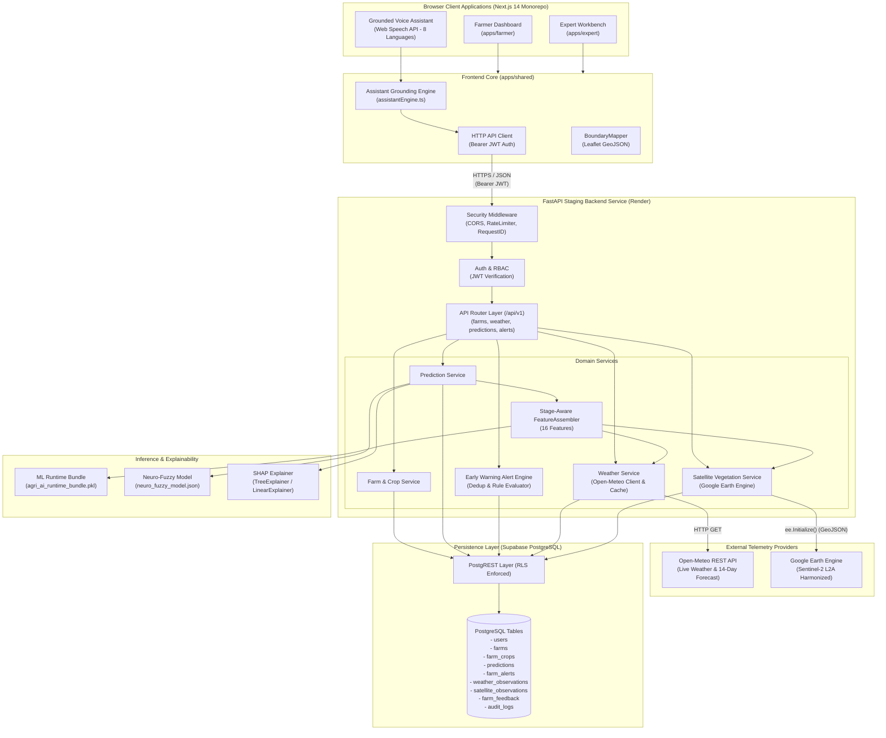
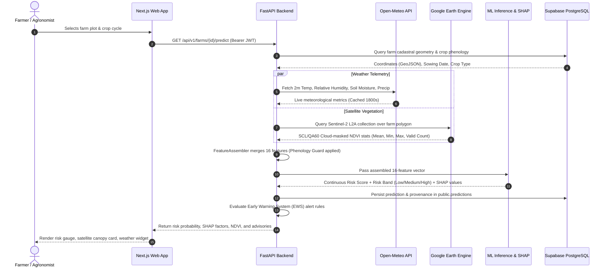

# CropAI: Reducing Crop Failure Using AI Under Unfavourable Weather Conditions

An enterprise-grade, multi-tenant agricultural intelligence platform designed to assist smallholder farmers, agricultural extension officers, agronomists, and researchers in estimating crop failure risks, exploring climate-resilient crop alternatives, and monitoring farm-level environmental stress.

---

## 🌐 Application Links & Deployment Status

| Service | Environment | Deployment URL | Operational Status |
| :--- | :--- | :--- | :--- |
| **V2 Web Application (Next.js)** | Production / Staging | [reducing-crop-failure-using-ai.vercel.app](https://reducing-crop-failure-using-ai.vercel.app) | **Live** (Hosted on Vercel) |
| **V2 Backend API (FastAPI)** | Staging | [cropai-backend-staging.onrender.com](https://cropai-backend-staging.onrender.com) | **Live — Staging** (Hosted on Render) |
| **Backend Health Check** | Staging | [cropai-backend-staging.onrender.com/health](https://cropai-backend-staging.onrender.com/health) | **Operational** (`HTTP 200: {"status":"ok"}`) |
| **Interactive API Docs (Swagger)** | Staging | [cropai-backend-staging.onrender.com/docs](https://cropai-backend-staging.onrender.com/docs) | **Live** (OpenAPI / Swagger UI) |
| **Source Code Repository** | Production | [github.com/iamvk09/reducing-crop-failure-using-ai](https://github.com/iamvk09/reducing-crop-failure-using-ai) | **Active** (Branch: `release/v2-staging`) |
| **V1 Prototype (Streamlit)** | Legacy Live | [reducecropfailure.onrender.com](https://reducecropfailure.onrender.com/) | **Preserved** (Independent V1 service) |

> [!NOTE]
> The backend URL is actively hosted on a **Render Staging Web Service** (`cropai-backend-staging.onrender.com`) running Python 3.12 via Uvicorn. The V1 Streamlit prototype operates on an isolated Render instance and is preserved independently.

---

## 📖 Overview & Problem Statement

Unfavourable weather conditions—including delayed monsoons, unseasonal downpours, dry spells, and temperature extremes—cause catastrophic yield reductions across India. Farmers often lack accessible, location-specific forecasts and scientific risk estimates prior to harvest failure.

**CropAI V2** bridges this gap by unifying:
1. **Cadastral Farm Boundaries**: Polygon GeoJSON cadastral mapping for registered farmer plots.
2. **Real-Time Meteorological Telemetry**: Free, keyless 2m dry-bulb temperature, relative humidity, multi-layer root-zone soil moisture, and accumulated precipitation from Open-Meteo.
3. **Orbital Vegetation Monitoring**: 10-meter native optical Sentinel-2 Level-2A Surface Reflectance (`COPERNICUS/S2_SR_HARMONIZED`) through Google Earth Engine (GEE).
4. **Machine Learning & Neuro-Fuzzy Risk Engine**: Dual inference model producing calibrated failure probabilities and explainable SHAP attributions.
5. **Grounded Multilingual Voice Assistant**: Zero-hallucination voice assistant supporting 8 Indian languages (Hindi, Marathi, Bengali, Telugu, Tamil, Kannada, Gujarati, English).

---

## 🚀 Key Features

| Feature | Subsystem | Status | Implementation Details |
| :--- | :--- | :--- | :--- |
| **Single-Login Architecture** | Auth / Frontend | **Implemented** | Authenticated users access farmer operations and the expert workbench in a unified Next.js web application. |
| **Cadastral Boundary Mapping** | Frontend (Leaflet) | **Implemented** | Interactive farm plot boundary drawer (`BoundaryMapper.tsx`) supporting GeoJSON polygons and Shoelace geodesic acreage. |
| **Live Weather Telemetry** | Backend / API | **Implemented** | Real-time weather, 7–14 day forecast, reverse-geocoding, and 1800s in-memory caching via Open-Meteo. |
| **Crop Risk Prediction** | ML / Backend | **Implemented** | 16-feature stage-aware vector processed by trained Random Forest / Gradient Boosted ensemble. |
| **SHAP Explainability** | ML / Backend | **Implemented** | Top-3 contributing risk drivers and protective factors per prediction computed using TreeExplainer / LinearExplainer. |
| **Early Warning System (EWS)** | Backend / DB | **Implemented** | Stateful alert engine tracking 6 condition triggers with deduplication and acknowledgment lifecycle. |
| **Takagi-Sugeno Neuro-Fuzzy Engine** | ML / Backend | **Implemented** | Transparent rule-based fuzzy logic engine (`models/neuro_fuzzy_model.json`) with Gaussian membership functions. |
| **Sentinel-2 NDVI Monitoring** | Satellite / GEE | **Implemented** | Harmonized Sentinel-2 Level-2A cloud-masked NDVI pipeline with native GEE server-side spatial reduction. |
| **Multilingual Voice Assistant** | Frontend / Web Speech | **Implemented** | Web Speech API recognition and synthesis grounded strictly in live telemetry across 8 Indian languages. |
| **Closed-Loop Feedback & Outcomes** | Backend / DB | **Implemented** | Ground-truth outcome collection (`farm_feedback`) for post-harvest model evaluation and validation. |
| **Row-Level Security (RLS)** | Database | **Implemented** | 12 forward SQL migrations enforcing PostgreSQL RLS across all 10 domain tables. |
| **SMS & WhatsApp Dispatches** | Notifications | **Implemented (Disabled)** | Twilio SMS/WhatsApp dispatcher with phone masking; toggled `false` by default for ₹0 budget compliance. |
| **Google Cloud OAuth** | Auth / Frontend | **Planned / In Progress** | Google OAuth button delegates to development role selector until OAuth Client IDs are configured. |
| **Automated Cron Poller** | Infrastructure | **Planned** | Telemetry and alerts currently refresh on user request/load; scheduled background cron worker is planned. |

---

## 🏛️ System Architecture

The following Mermaid diagram outlines the architecture, data flows, and security boundaries across the V2 web platform:



---

## 🛰️ The Telemetry–Prediction Pipeline (Open-Meteo + GEE + ML)

The end-to-end telemetry and prediction pipeline operates under strict data provenance and agronomic integrity rules:



### Telemetry & Provenance Rules:
1. **Weather Telemetry (Open-Meteo)**:
   - Provides 2-meter dry-bulb temperature (°C), relative humidity (%), precipitation (mm), and root-zone soil moisture relative saturation across 4 ECMWF Land depth layers (0–1cm, 1–3cm, 3–9cm, 9–27cm).
   - Metrics older than 24 hours are flagged as stale.
2. **Sentinel-2 Surface Reflectance (Google Earth Engine)**:
   - Queries `COPERNICUS/S2_SR_HARMONIZED` within a 45-day lookback window.
   - Dual-stage cloud filtering masks SCL shadow/cloud classes (3, 8, 9, 10, 11) and QA60 opaque/cirrus bitmasks (bits 10 & 11).
   - Computes standard NDVI: $\text{NDVI} = \frac{\text{B8} - \text{B4}}{\text{B8} + \text{B4}}$.
   - Cloud spatial reduction is executed directly on GEE cloud servers at 10m native resolution across the farm polygon.
3. **Phenology Guard**:
   - Live Sentinel-2 NDVI is **only** substituted into the model's `NDVI_Flowering` feature if the crop is in its active flowering stage (evaluated by phenological stage keywords or Days After Sowing within crop-specific flowering windows, e.g., Rice 55–90 DAS, Wheat 60–90 DAS, Cotton 70–115 DAS). Otherwise, calibrated historical district baselines are retained with explicit provenance.
4. **Honest Observability**:
   - When satellite observations are blocked by clouds or unconfigured, the system reports status `SATELLITE_NO_VALID_OBSERVATION` or `SATELLITE_NOT_CONFIGURED` without crashing or inventing synthetic values.

---

## 🔬 Machine Learning & Prediction Engine

### 1. Trained Model Bundle (`models/agri_ai_runtime_bundle.pkl`)
The primary predictor is a calibrated ensemble trained on comprehensive Indian agricultural datasets:
- **Algorithms**: Calibrated Random Forest (`RandomForestClassifier`) combined with Gradient Boosting estimators.
- **Risk Calibration**: Maps continuous risk probabilities to 3 distinct operational bands:
  - **Low Risk**: $[0.00, 0.45)$
  - **Medium Risk**: $[0.45, 0.70)$
  - **High Risk**: $[0.70, 1.00]$
- **16 Input Features**:
  - **6 Categorical**: `State`, `Region`, `Season`, `Crop`, `SoilType`, `IrrigationLevel`.
  - **10 Numerical**: `Year`, `Rainfall` (mm), `Temperature` (°C), `Humidity` (%), `SoilMoisture` (%), `NDVI_Flowering` (0–1), `WaterStress` (0–1), `PestRisk` (0–1), `SuitabilityScore` (0–1), `YieldIndex` (0–250).

### 2. Neuro-Fuzzy Inference System (`models/neuro_fuzzy_model.json`)
A complementary Takagi-Sugeno fuzzy logic architecture using Gaussian bell membership antecedents across 8 environmental features and 6 agronomic rules, providing transparent rule validation for researchers.

### 3. SHAP Explainability Engine
Generates local feature attributions using `TreeExplainer` and `LinearExplainer`. Explains predictions by surfacing the top-3 contributing risk factors and top protective mitigating factors.

---

## 🚨 Early Warning System (EWS)

The Early Warning System (`backend/app/services/alert_service.py`) evaluates 6 deterministic conditions against live telemetry and prediction history:

| Alert Trigger | Severity | Condition | Recommended Action |
| :--- | :--- | :--- | :--- |
| `RISK_THRESHOLD_CROSSED` | **Critical / High** | Prediction risk probability crosses medium ($0.45$) or high ($0.70$) threshold | Review agronomic advisory and consider emergency protective interventions. |
| `RISK_TREND_INCREASING` | **High** | Consecutive assessments show $\ge 15\%$ increase in failure probability | Inspect farm for acute moisture deficit or pest escalation. |
| `TELEMETRY_DEGRADATION` | **Medium** | Weather station or satellite observation missing during active vegetative stage | Re-verify farm cadastral coordinates or inspect on-ground sensors. |
| `SATELLITE_STALE` | **Low** | No cloud-free Sentinel-2 observation available in the last 21 days | Rely on ground visual inspections until the next clear orbital pass. |
| `WEATHER_STALE` | **Medium** | Meteorological data has not updated for $> 48$ hours | Check local network connectivity or weather station status. |
| `DATA_QUALITY_DEGRADED` | **Medium** | Over 50% of assembled features rely on fallback district baselines | Update crop planting dates and soil profile in farm settings. |

- **Lifecycle Management**: Alerts transition through `active` $\rightarrow$ `acknowledged` $\rightarrow$ `resolved` states.
- **Deduplication**: SHA-256 fingerprinting prevents alert storms.

---

## 🎙️ Multilingual AI Voice Assistant

The voice assistant interface (`VoiceAssistantPanel.tsx`) provides hands-free accessibility for rural smallholders:
- **Zero Hallucination Grounding**: Powered by `assistantEngine.ts`, answers are resolved deterministically from authenticated farm telemetry, live Open-Meteo weather, Sentinel-2 observations, and SHAP drivers.
- **Web Speech API**: Uses browser-native speech recognition (`webkitSpeechRecognition`) and speech synthesis (`speechSynthesis`).
- **8 Supported Languages**: Hindi (`hi-IN`), Marathi (`mr-IN`), Bengali (`bn-IN`), Telugu (`te-IN`), Tamil (`ta-IN`), Kannada (`kn-IN`), Gujarati (`gu-IN`), English (`en-IN`).
- **Action Confirmation**: Critical commands (such as running a new assessment or acknowledging alerts) require explicit user voice or button confirmation.

---

## 🗂️ Project Directory Structure

```text
ai-crop-failure-project/
├── apps/
│   ├── expert/                  # Next.js 14 Expert & Agronomist Workbench
│   │   ├── app/                 # Diagnostic views, scenario twin, SHAP analytics
│   │   └── package.json         # Workspace package configuration
│   ├── farmer/                  # Next.js 14 Farmer Dashboard (Mobile-first)
│   │   ├── app/                 # Farm plot cards, weather widget, voice assistant
│   │   └── package.json         # Workspace package configuration
│   └── shared/                  # Shared TypeScript library
│       ├── api/                 # Typed API client abstractions
│       ├── components/          # Reusable components (BoundaryMapper, VoiceAssistant)
│       ├── context/             # AuthContext, UserLocationContext
│       └── services/            # assistantEngine.ts (Grounded Voice Assistant)
├── backend/
│   ├── app/
│   │   ├── api/routes/          # FastAPI routers (farms, weather, predictions, alerts)
│   │   ├── core/                # config, security, rate_limiter, logging, supabase
│   │   ├── repositories/        # Database access layer (Supabase PostgREST)
│   │   ├── schemas/             # Pydantic v2 schemas with validation
│   │   ├── services/            # Domain services (prediction, satellite, weather, alerts)
│   │   └── main.py              # FastAPI application entrypoint
│   ├── requirements.txt         # Backend Python dependencies
│   └── tests/                   # Pytest automated test suite (235 tests)
├── data/                        # District baselines and historical observations
├── models/                      # ML bundles and neuro-fuzzy configurations
├── scripts/
│   └── security_check.py        # Automated repository secret scanner
├── src/                         # ML inference, feature engineering, and legacy code
├── supabase/
│   └── migrations/              # 12 Forward PostgreSQL SQL migrations (001 to 012)
├── .env.example                 # Safe environment configuration template
├── .python-version              # Pinned Python runtime (3.12.11)
├── package.json                 # Monorepo npm workspaces configuration
├── pytest.ini                   # Pytest discovery and warning configuration
└── README.md                    # Project documentation
```

---

## 💻 Local Setup & Installation

### Prerequisites
- **Python**: 3.10 to 3.12 (Python 3.12 recommended; Render staging uses Python 3.12 via `.python-version`).
- **Node.js**: Node 20.x or later with `npm`.
- **Git**: Installed.

### 1. Backend Service Setup (FastAPI)
```powershell
# Open terminal in project root
python -m venv venv
.\venv\Scripts\activate

# Install backend dependencies
python -m pip install --upgrade pip
pip install -r backend/requirements.txt -r requirements.txt

# Start local FastAPI server
uvicorn backend.app.main:app --reload --host 127.0.0.1 --port 8000
```
- API Base URL: `http://127.0.0.1:8000`
- Interactive Swagger Docs: `http://127.0.0.1:8000/docs`
- Health Endpoint: `http://127.0.0.1:8000/health`

### 2. Frontend Applications Setup (Next.js)
In a separate terminal window:
```powershell
# Install root and workspace dependencies
npm install

# Run the Farmer Next.js app (Port 3000)
npm --prefix apps/farmer run dev

# Run the Expert Next.js app (Port 3001)
npm --prefix apps/expert run dev -- -p 3001
```

### 3. Run Automated Tests
```powershell
# Run complete backend pytest suite (235 tests)
.\venv\Scripts\activate
py -3 -m pytest backend/tests

# Run satellite regression tests specifically
py -3 -m pytest backend/tests/test_satellite.py

# Run frontend test scripts
npm run test:frontend

# Run repository secret audit
py -3 scripts/security_check.py
```

---

## 🔑 Environment Variables & Configuration

Copy `.env.example` to `.env` for local development. **Never commit `.env` files to Git.**

| Variable Name | Scope | Description | Safe Example Placeholder |
| :--- | :--- | :--- | :--- |
| `APP_ENV` | Backend | Environment mode (`development`, `staging`, `production`) | `development` |
| `PORT` | Backend | Web service port | `8000` |
| `CORS_ORIGINS` | Backend | Allowed frontend origin list | `["http://localhost:3000"]` |
| `SUPABASE_URL` | Backend | Supabase project API URL | `https://your-project.supabase.co` |
| `SUPABASE_PUBLISHABLE_KEY` | Backend | Public anonymous API key | `your-supabase-publishable-key` |
| `SUPABASE_SECRET_KEY` | Backend Only | Service-role administrative key | `your-supabase-secret-key` |
| `SUPABASE_JWT_SECRET` | Backend Only | Secret for verifying auth JWTs | `your-supabase-jwt-secret` |
| `NEXT_PUBLIC_SUPABASE_URL` | Frontend Safe | Public Supabase URL | `https://your-project.supabase.co` |
| `NEXT_PUBLIC_SUPABASE_PUBLISHABLE_KEY` | Frontend Safe | Public Supabase API key | `your-supabase-publishable-key` |
| `OPENMETEO_BASE_URL` | Backend | Weather API URL (free & keyless) | `https://api.open-meteo.com/v1/forecast` |
| `GEE_PROJECT_ID` | Backend Only | Google Cloud Project with Earth Engine API | `crop-failure-ai` |
| `GEE_SERVICE_ACCOUNT_EMAIL` | Backend Only | Service account email | `sa@project.iam.gserviceaccount.com` |
| `GEE_PRIVATE_KEY` | Backend Only | Service account PEM private key | `your-escaped-private-key-placeholder` |
| `SMS_ENABLED` | Backend | Master switch for SMS dispatch | `false` |
| `WHATSAPP_ENABLED` | Backend | Master switch for WhatsApp dispatch | `false` |

---

## 🗄️ Database Setup & Migrations

Database persistence is powered by PostgreSQL via Supabase with Row-Level Security (RLS). Migrations located in `supabase/migrations/` must be applied in sequential order:

1. `001_initial_schema.sql`: Core tables (`users`, `farms`, `farm_crops`, `predictions`, `farm_alerts`, `audit_logs`).
2. `002_auth_and_rls_hardening.sql`: Non-recursive role lookups and tenant isolation policies.
3. `003_prediction_persistence.sql`: Prediction history, recommendations, and feature provenance schemas.
4. `004_weather_data.sql`: Weather observation cache table.
5. `005_satellite_observations.sql`: Satellite observations with NDVI statistics and quality flags.
6. `006_grant_permissions_and_fix_rls.sql`: Least-privilege grants for `anon`, `authenticated`, and `service_role`.
7. `007_satellite_unique_farm_observation_date.sql`: Unique deduplication index on satellite records.
8. `008_farm_boundary_geometry.sql`: Polygon GeoJSON support for farm boundaries.
9. `009_closed_loop_feedback_and_outcomes.sql`: Closed-loop farmer feedback and actual yield outcomes.
10. `010_early_warning_alerts.sql`: Early warning alert engine schema (`farm_alerts`).
11. `011_sms_notifications.sql`: Notification audit trail (`notification_dispatches`) and user consent.
12. `012_fix_user_metadata_rls.sql`: Enforces immutable role security triggers and prevents privilege escalation.

---

## 🛡️ Security Audit & Responsible Use

### 1. Security Scanner & Auditing
The repository maintains an automated secret scanner (`scripts/security_check.py`) that executes in CI/CD and pre-commit checks:
- Scans for private cryptographic keys (`BEGIN PRIVATE KEY`), live JWTs, cloud provider keys, and unencrypted credentials.
- Strictly validates that `.env`, `.env.local`, and service account JSON files are never tracked.

### 2. Tenant Isolation & Defense-in-Depth
- **PostgreSQL Row-Level Security**: Every query is scoped to `auth.uid()` or validated farm ownership. Farmers cannot access other users' farms, predictions, or alerts.
- **In-Memory Rate Limiting**: Sliding-window rate limiter prevents credential brute-forcing and API abuse.
- **Header Hardening**: Enforces `X-Content-Type-Options: nosniff`, `X-Frame-Options: DENY`, and correlation `X-Request-ID`.
- **Zero Credential Logging**: All loggers across backend services explicitly redact private keys, tokens, and authorization headers.

---

## ⚠️ Known Limitations & Roadmap

### Known Limitations
- **Cloud Obscuration**: Optical Sentinel-2 imagery cannot penetrate dense monsoon cloud cover. During heavy cloud cover ($> 30\%$), the pipeline gracefully defaults to calibrated historical district baselines.
- **Multi-Worker Rate Limiting**: The current rate limiter uses an in-memory sliding window per process. Distributed clustering will transition to Redis in Phase 3.
- **SMS / WhatsApp Dispatches**: Intentionally suppressed (`SMS_ENABLED=false`) during staging to maintain ₹0 trial budget.

### Future Roadmap
- [ ] Automated asynchronous daily alert evaluation worker (Celery/Redis or pg_cron).
- [ ] Offline-first Progressive Web App (PWA) caching for low-connectivity rural field use.
- [ ] Multi-spectral synthetic aperture radar (Sentinel-1 SAR) integration for cloud-penetrating moisture tracking.
- [ ] Hyperlocal IoT soil sensor integration.

---

## 👥 Authors & Acknowledgements

- **Project Lead & Developer**: Vibhor Kumar ([@iamvk09](https://github.com/iamvk09))
- **Data & Telemetry Providers**:
  - European Space Agency (ESA) & Copernicus Open Access Hub for Sentinel-2 MSI data.
  - Google Earth Engine for cloud-native planetary geospatial reduction.
  - Open-Meteo for free, keyless meteorological forecasts and ECMWF Land reanalysis.
  - Directorate of Economics and Statistics (DES), Ministry of Agriculture & Farmers Welfare, India, for historical district agricultural baselines.
